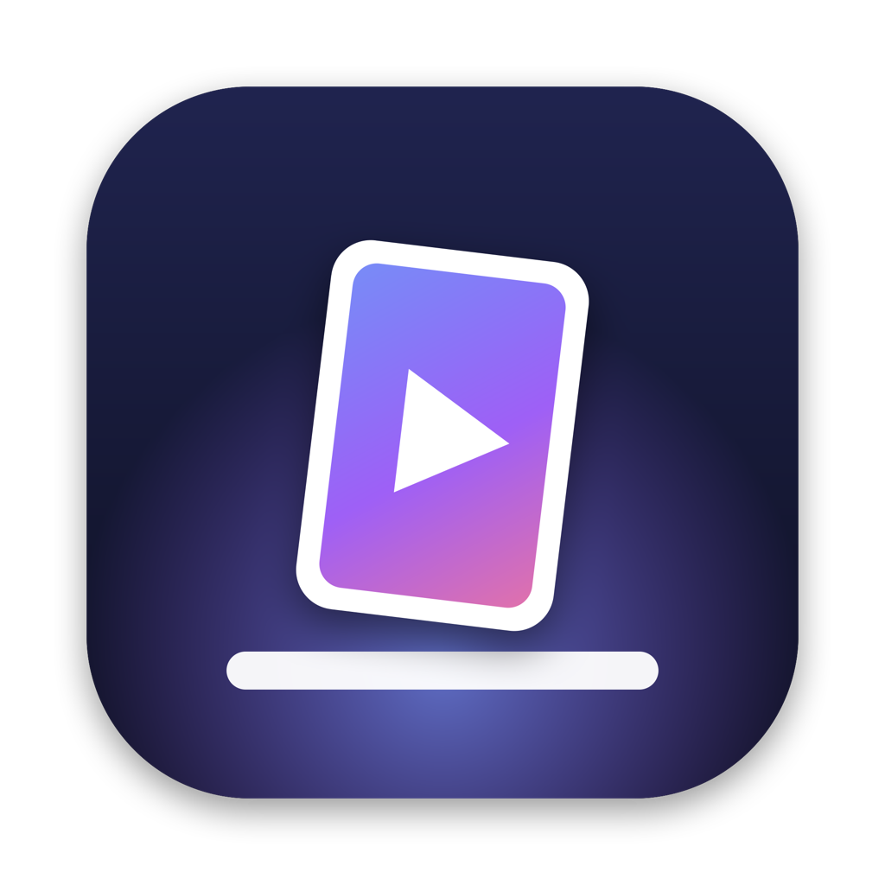
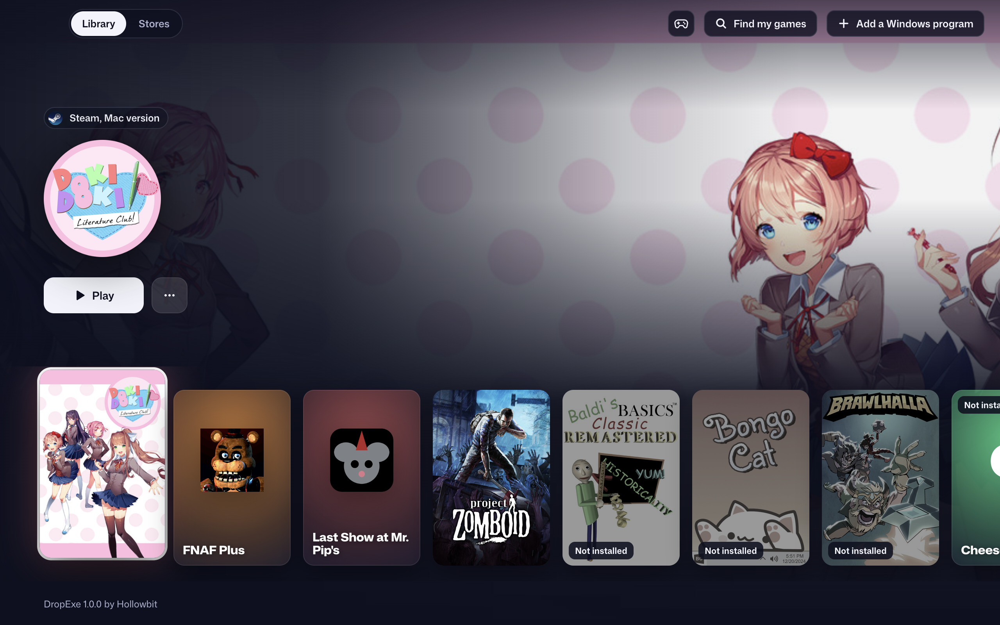

<p align="center">
  <a href="https://hollowbit.dev/dropexe/"></a>
</p>

<h1 align="center">DropExe</h1>

<p align="center"><b>Windows games on your Mac. Free.</b></p>
<p align="center">A free alternative to CrossOver, for Apple Silicon Macs.</p>

<p align="center">
  <a href="https://github.com/hollowbit-dev/dropexe/releases/latest"></a>
  
  
  <a href="LICENSE"></a>
</p>

<p align="center"></p>

## What it does

- **One shelf for every game.** *Find my games* pulls in your Steam library (with Steam's own art and logos), Windows games in your folders, and your Mac games.
- **Drop an .exe.** Drag any Windows game, app or installer onto the window. DropExe runs installers, finds what they added, and names it with its real icon.
- **One-click stores.** Steam and Epic Games install with one button. GOG Galaxy and Battle.net open their own installers.
- **Make it run.** If a game crashes or won't start, DropExe tries one fix at a time (Metal, Vulkan or classic graphics, Microsoft runtimes, Windows 7 mode, a window) and keeps the first that works.
- **Real Mac apps.** Add any game to Launchpad and Spotlight.
- **The rest:** Retina sharpness switch, controller check, play time, and Remove that can move a game's files to the Trash.

> Ubisoft Connect and the EA app don't work yet. Games with anti-cheat or DirectX 12 usually won't run. Windows-only Steam games need DropExe's own Steam (Stores tab).

## Install

Download the .dmg from the [latest release](https://github.com/hollowbit-dev/dropexe/releases/latest) and drag DropExe to Applications. The first time, right-click it and choose **Open**, because the app isn't signed yet. On first launch DropExe downloads its Windows engine (about 240 MB, plus about 240 MB more if you add Steam).

## How it works

DropExe is a launcher built on free, open-source work:

- [Wine](https://www.winehq.org/) (LGPL), using [Gcenx's macOS builds](https://github.com/Gcenx/macOS_Wine_builds) for games and apps
- [Sikarugir](https://github.com/Sikarugir-App)'s Wine 10 engine for Steam, whose window stays black on Wine 11
- [DXMT](https://github.com/3Shain/dxmt) (DirectX 11 to Metal) and [DXVK-macOS](https://github.com/Gcenx/DXVK-macOS) (DirectX to Vulkan)
- [Mona Sans](https://github.com/github/mona-sans) (OFL) for the interface

Thanks to [Highball](https://github.com/gauthierpiarrette/highball), whose open notes helped pin down the Steam window problem. None of these engines are bundled in this repo: DropExe downloads them from their own releases on first use.

## Develop

```sh
npm install
npm start
node test/shots.mjs /tmp/shot   # demo screenshots
```

## More free apps from Hollowbit

- **[Melodyshaper](https://hollowbit.dev/melodyshaper/)**: hum a tune into a song
- **[Clipshaper](https://hollowbit.dev/clipshaper/)**: long videos to short clips
- **[Diskshaper](https://hollowbit.dev/diskshaper/)**: free up disk space safely
- **[Fileshaper](https://hollowbit.dev/fileshaper/)**: compress, convert, sign PDFs
